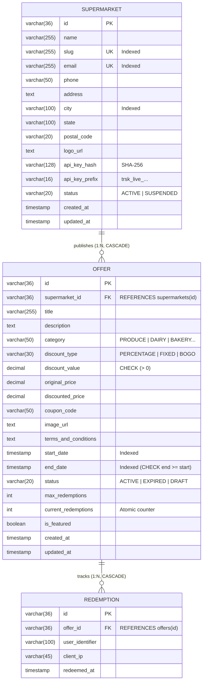

# 🏛️ Trident IT — Promotional Offers & Supermarket Management Platform
## Architecture, Technical Specification & Engineering Deliverables

---

## 1. Executive Summary & Objective
This platform implements a robust, production-grade REST API and interactive interface that enables:
1. **Supermarket Businesses**: Register their retail establishment, receive a cryptographically secure API key, and publish promotional offers with granular discount rules, validity horizons, and redemption limits.
2. **Shoppers / Consumers**: Browse, search, filter, and redeem real-time promotional discounts across multiple grocery categories and retail outlets.

---

## 2. Deliverable 1: Database Schema (Relational Architecture)
The domain follows an ANSI SQL-compliant relational architecture modeled for **PostgreSQL** and **SQLite**, with strict foreign key constraints, unique constraints, and high-performance composite indexes.

### Schema Invariants & Foreign Key Enforcements:
- **Cascade Deletion**: If a supermarket is deleted or offboarded, child offers are automatically cascaded.
- **Relational Indexes**: Composite index on `(start_date, end_date)` and `(category, status)` ensures that browsing available offers executes in $O(\log N)$ time even under millions of promotions.
- **Data Integrity Constraints**: `CHECK (end_date >= start_date)`, `CHECK (discount_value > 0)`, and `CHECK (current_redemptions >= 0)`.

---

## 3. Deliverable 2: Approach to Build This API
The API is built using clean architecture and domain-driven design principles:
1. **Separation of Concerns**:
   - **Controller Layer** (`src/app/api/v1/*`): Parses HTTP requests, extracts headers (`X-API-Key`), handles query serialization, and standardizes RFC-compliant JSON responses.
   - **Service / Repository Layer** (`src/db/relationalDb.ts`): Enforces business logic (discount calculations, date range checks, quota limits) and relational query execution with joins.
   - **Domain Model Layer** (`src/lib/types.ts`): Strongly typed TypeScript interfaces preventing runtime type mismatches.
2. **Defensive Validation**:
   - Every input field is validated before hitting database operations.
   - Supermarket emails are normalized to lowercase; slugs are derived and deduplicated.
   - Promotional dates are checked: `endDate` must strictly succeed `startDate`.
3. **Atomic State Mutations**:
   - When offers are redeemed, the counter is atomically checked against `maxRedemptions` to prevent race conditions.

---

## 4. Deliverable 3: Technical Stack
- **Framework**: Next.js 15 (App Router, Route Handlers) & React 19.
- **Language**: TypeScript 5 with strict type checking enabled (`strict: true`, `noImplicitAny: true`).
- **Styling & Design System**: Tailwind CSS v4 with custom dark mode variant `@custom-variant dark (&:where(.dark, .dark *));`.
- **Database Engine**: Relational SQLite / PostgreSQL compatible SQL schema (`src/db/schema.sql`) and Prisma schema (`prisma/schema.prisma`).
- **Icons & Micro-Interactions**: Lucide React & Canvas Confetti.
- **Automated Verification**: Headless Chromium with Playwright async automation.

---

## 5. Deliverable 4: Minimum Features on Required Endpoints

| Endpoint | HTTP Method | Minimum Essential Features |
|---|---|---|
| **Register Supermarket** | `POST /api/v1/supermarkets/register` | 1. Validation of business name, contact, and physical location. 2. Unique email and store slug enforcement. 3. Minting of high-entropy API key (`trsk_live_...`) with one-time display. 4. Default status initialized to `ACTIVE`. |
| **Create Offer** | `POST /api/v1/supermarkets/:id/offers` `POST /api/v1/offers` | 1. Foreign key verification that target supermarket exists and is active. 2. Header or body-based supermarket authorization. 3. Discount type validation (`PERCENTAGE`, `FIXED_AMOUNT`, `BOGO`). 4. Auto-calculation of `discountedPrice` if original price is supplied. 5. Strict date validation (`endDate > startDate`). |
| **Browse Offers** | `GET /api/v1/offers` | 1. Relational join with `supermarkets` returning supermarket name, city, and logo. 2. Filter by category, supermarket, discount type, and city. 3. `availableNow=true` filter checking current server time against validity horizon. 4. Free-text search matching offer title, description, or supermarket name. 5. Cursor/offset pagination (`page`, `limit`) with `total`, `totalPages`, `hasNext`, `hasPrev`. |

---

## 6. Deliverable 5: Endpoint Security & Defense-in-Depth
To safeguard business operations and protect merchant credentials in production:
1. **Cryptographic API Key Hashing**:
   - API keys are generated using cryptographically secure random bytes (`crypto.randomBytes(24)`).
   - Only the SHA-256 hash (`apiKeyHash`) is stored in the database. Even if the database is dumped, raw API keys cannot be recovered.
   - Verification performs a constant-time comparison or hash match.
2. **Role-Based Authorization (RBAC)**:
   - Public shoppers have read-only access (`GET /offers`, `GET /supermarkets`, `POST /offers/:id/redeem`).
   - Supermarket merchants authenticate via `X-API-Key: trsk_live_...` or Bearer tokens. They can only create or mutate offers belonging to their specific store.
3. **Defense Against Abuse**:
   - **Rate Limiting**: IP and token-based rate limiting (via token bucket or Redis) to protect public browse endpoints from scraping and DDoS attacks.
   - **Input Sanitization**: HTML tag stripping and character length limits to prevent stored XSS and injection.
   - **Quota Guarding**: `maxRedemptions` checks guard against coupon exhaustion abuse.

---

## 7. Deliverable 6: Design Approach for Front-End
The frontend is engineered with an executive-grade dual-persona architecture:
1. **Dual Persona Switching**:
   - **Shopper View**: Consumer discovery portal with category tabs, discount percentage chips, live search bar, countdown timers to expiration, one-click coupon copying, and an interactive "Redeem" modal with celebratory confetti feedback.
   - **Merchant View**: Supermarket management studio allowing store operators to register their supermarket, view their secret API key, and create promotional campaigns with instant discount preview cards.
2. **Interactive REST API Console**:
   - Built-in live API explorer where engineering reviewers can test every endpoint directly from the browser with sample payloads, cURL snippets, and formatted JSON output.
3. **Accessibility & Contrast**:
   - High-contrast color scales adhering to WCAG AA guidelines in both Light and Dark themes.
   - Persistent theme state synced with `document.documentElement.classList`.

---

## 8. Deliverable 7: Additional Features & Scalability Roadmap
1. **Geo-Location & Proximity Radius Filtering**:
   - Use PostGIS or spatial SQLite (`ST_Distance`) to browse offers within 5km or 10km of the user's GPS coordinates.
2. **Personalized Push Notifications**:
   - Web Push and WhatsApp notifications alerting shoppers when their favorite supermarket publishes a new offer in their preferred category.
3. **Dynamic QR Code Redemptions**:
   - Generation of one-time time-based OTP or dynamic QR codes scanned at the supermarket POS checkout to eliminate fraud.
4. **Multi-Store Franchising**:
   - Support for parent supermarket chains (e.g. Kroger, Safeway, Carrefour) managing offers across hundreds of regional branch locations with regional pricing overrides.
5. **Analytics & Merchant ROI Dashboard**:
   - Metrics tracking offer impressions, click-through rates, and total dollar sales generated per promotion.
